  

  <a href="https://raihanzaky.my.id">raihanzaky.my.id</a> &nbsp;·&nbsp;
  <a href="https://linkedin.com/in/raihannzaky">LinkedIn</a> &nbsp;·&nbsp;
  <a href="mailto:raihanzaky0515@gmail.com">Email</a> &nbsp;·&nbsp;
  <a href="https://raihanzaky.my.id/CV_M.Raihan%20Zaky%20Mahendra.pdf">CV</a>

I'm a Computer Science student at Universitas Pakuan. I build end-to-end — ML models, web apps, and the Linux servers they run on. Most of it starts with a real problem and ends with something people can actually use.

### Now

- Building **RadialDeck** — a radial file-conversion and actions overlay for KDE Plasma, written in Rust.
- Running a self-hosted AI stack at home: Docker, Tailscale, local LLMs, and a growing pile of YAML.
- Teaching assistant at Labkom Maroon, Universitas Pakuan — AI, web technology, and databases.
- Open to a **software / web development internship**.

### Selected work

**[RadialDeck](https://github.com/ReyyIchiro/radialdeck)** — Radial file-conversion and actions overlay for KDE Plasma. Ten format categories, 26 tools, keyboard-first. `Rust` `GTK4` `Wayland`

**[Aksaraku](https://aksaraku.vercel.app)** — RAG-based AI mentor for learning Javanese script, with a multi-role school portal. `FastAPI` `Gemini` `Supabase` · [source](https://github.com/ReyyIchiro/project-necad)

**[Batik Motif Classification](https://github.com/ReyyIchiro/batik-motif-classification)** — GLCM texture features and an SVM to classify Indonesian batik motifs, served through Flask. `Python` `scikit-learn` `Flask`

**[Workspace Bar](https://github.com/ReyyIchiro/workspace-bar-kde-plasma)** — KDE Plasma 6 widget that brings GNOME's workspace bar to Plasma: desktop pills with live window icons. `QML` `Plasma 6`

In private repos: Next.js/Laravel client apps, attendance, a RAG academic chatbot, and Discord infrastructure. Happy to walk through them.

More projects on my <a href="https://raihanzaky.my.id">portfolio</a> →

### Toolbox

**Languages** — Python · TypeScript · JavaScript · PHP · Dart · Rust · SQL\
**Web** — React · Next.js · Node.js · Laravel · Flask · FastAPI · Tailwind CSS\
**AI & data** — PyTorch · TensorFlow · scikit-learn · OpenCV · Pandas · LangChain · Ollama\
**Infra & tools** — Docker · Linux · Nginx · PostgreSQL · MySQL · Supabase · Google Cloud · Figma

---

  

